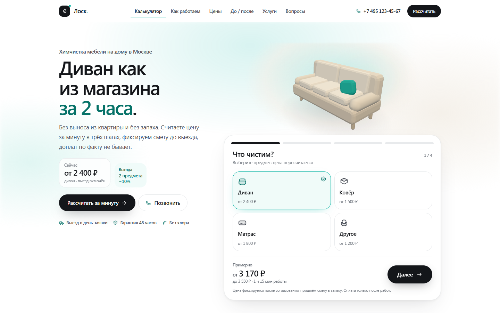
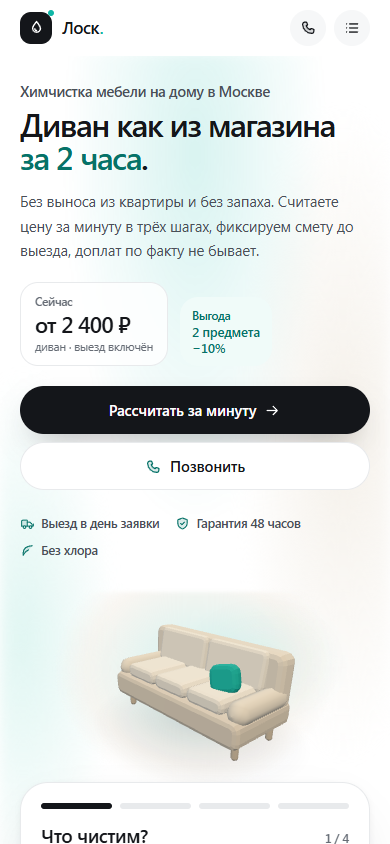
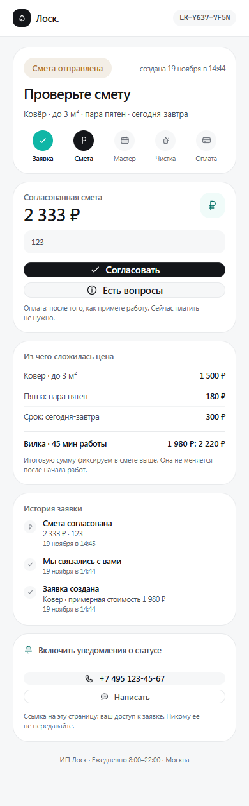
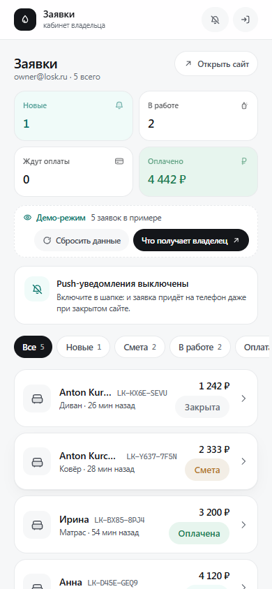
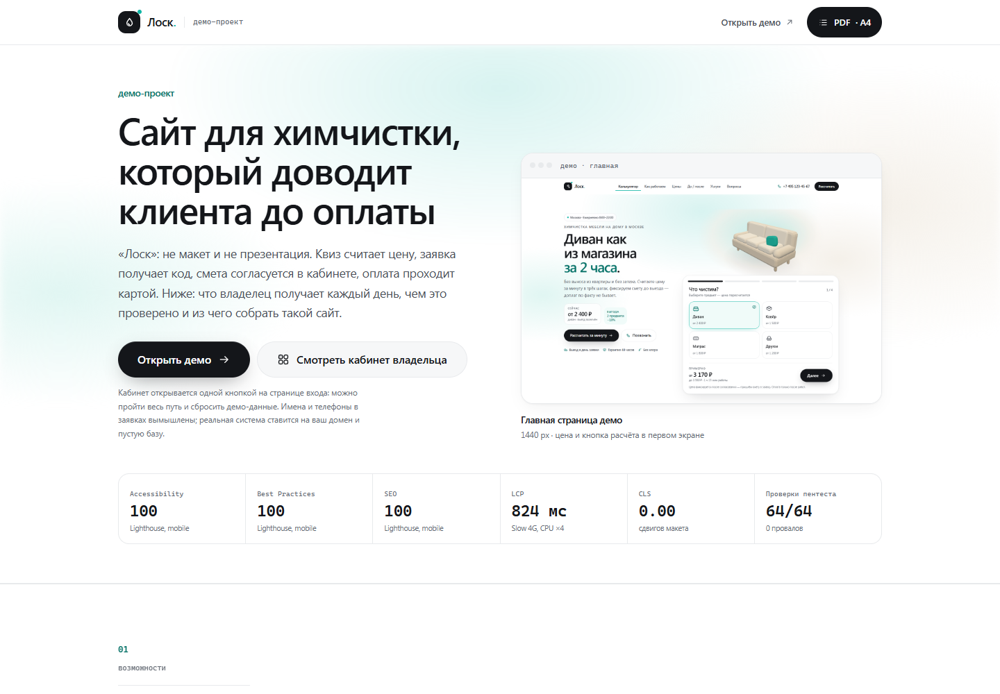
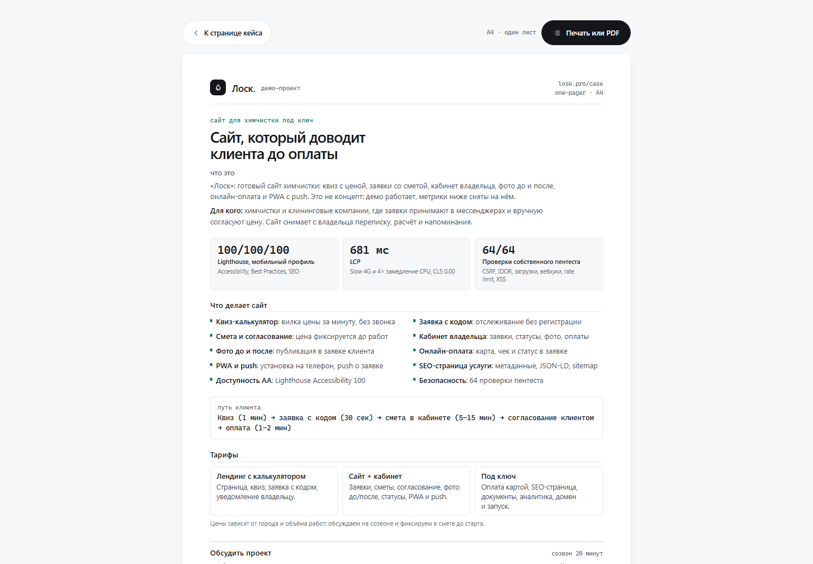

# Лоск — сайт химчистки мебели с PWA, кабинетом владельца и оплатой

Одностраничный продукт для химчистки мягкой мебели на дому: калькулятор-квиз,
заявки с согласованием цены, личный кабинет владельца, фото «до/после»,
онлайн-оплата и push-уведомления. Мобильный дизайн — первичен.

| | |
|---|---|
|  |  |
|  |  |
|  |  |

Остальные экраны — в [`docs/screenshots`](./docs/screenshots):
«до/после», карточка заявки в кабинете, страница оплаты, SEO-лендинг.
Печатный одностраничник: [`docs/losk-case.pdf`](./docs/losk-case.pdf) (генерируется
`npm run case:pdf`), онлайн-версия — `/case/print`.


```
Бренд:   Лоск (LOSK) — «диван как из магазина за 2 часа»
Стек:    Next.js 15 (App Router) · React 19 · TypeScript · Tailwind v4
          React Three Fiber 9 (софт-3D объекты) · web-push · zod
Данные:   SQLite через встроенный node:sqlite — миграции, индексы, транзакции,
          WAL. Без нативных зависимостей и без внешней БД для запуска.
Хостинг:  любой Node-хостинг (next start), либо VPS; для serverless — см. §Продакшен
```

---

## Быстрый старт

```bash
cd химчистка
npm install
# .env.local уже содержит сгенерированные секреты и DEMO_MODE=1

npm run build && npm start      # http://localhost:3210
# локальный production по http:// → COOKIE_INSECURE=1 npm start
```

Демо-данные создаются автоматически при первом запуске (`DEMO_MODE=1`):
3 заявки в разных статусах и опубликованная пара «до/после».

- **Демо-вход в кабинет:** на `/admin/login` кнопка «Открыть демо-кабинет».
- **Логин по паролю:** `owner@losk.ru` / значение `ADMIN_PASSWORD` из `.env.local`.
- **Сброс демо:** кнопка «Сбросить данные» в кабинете или `npm run seed`.

### Режим демонстрации (DEMO_MODE)

`DEMO_MODE=1` включает три вещи, которых **не должно быть в продакшене**:

| Что | Зачем |
|---|---|
| Автосев демо-заявок при первом запуске | кабинет и галерея никогда не пустые |
| Вход в кабинет в один клик (`/api/demo/login`) | клиент не вводит пароль на показе |
| Сброс данных (`/api/demo/reset`, только владелец) | «покажите ещё раз с начала» |

Все три жёстко закрыты флагом: при `DEMO_MODE=0` маршруты отвечают `404`,
кнопки не рендерятся, а демо-логин не существует. Перед публикацией — выключить.

### Скрипты

| Команда | Что делает |
|---|---|
| `npm run dev` | dev-сервер на :3210 |
| `npm run build` / `npm start` | production-сборка и запуск |
| `npm run typecheck` | `tsc --noEmit` |
| `npm run seed` | пересоздать демо-данные через API (нужен запущенный сервер) |
| `npm run case:pdf` | отрендерить `/case/print` в `docs/losk-case.pdf` через headless Chrome |
| `npm run pentest` | 72 проверки против запущенного инстанса, отчёт в `security/reports/` |
| `npm run e2e:photo` | сквозная проверка: фото в форме, заявка, кабинет владельца |

### Переменные окружения

Смотрите `.env.example`. Обязательны в продакшене:

```
NEXT_PUBLIC_SITE_URL   # https://ваш-домен — canonical, OG, ссылки в push
SESSION_SECRET         # openssl rand -hex 32
CSRF_SECRET            # openssl rand -hex 32
PAYMENT_WEBHOOK_SECRET # openssl rand -hex 32
ADMIN_EMAIL / ADMIN_PASSWORD
```

VAPID-ключи для push генерируются автоматически при первом обращении и
сохраняются в `data/secrets.json` (или задаются через `VAPID_PUBLIC_KEY` /
`VAPID_PRIVATE_KEY`).

---

## Что умеет

### Публичная часть

- **Оффер + цена + быстрый контакт** в первом экране, CTA ведёт в калькулятор.
- **Квиз-калькулятор из 4 шагов**: что чистим → размер и количество → пятна и
  срок → контакты. Цена пересчитывается на каждом шаге, до ввода телефона.
  Четвёртый вариант — «Другое» (кресла, стулья, шторы) со своей 3D-моделью.
- **Мягкие 3D-объекты** на React Three Fiber: диван, ковёр, матрас, кресло.
  Процедурная геометрия (~1.5–2.5k треугольников), матовые материалы, реакция
  на курсор, заморозка при `prefers-reduced-motion`, остановка рендера вне экрана.
- **Блок «Как мы работаем»** — 4 шага с таймингами.
- **«До / после»** с перетаскиваемым ползунком: реальные фото из заявок, если
  владелец их опубликовал, иначе — процедурное сравнение ткани.
- **Прайс-лист**, отзывы, FAQ (`<details>`), финальный CTA, sticky-CTA на телефоне.
- **SEO-страница** `/chistka-mebeli-na-domu`: длинный лендинг, прайс-таблица,
  FAQ + JSON-LD (Service, FAQPage, BreadcrumbList), внутренние ссылки.
- `/privacy`, `/offer`, `/contacts` — политика ПДн, оферта, реквизиты.

### Заявка и согласование

1. Клиент отправляет заявку → получает код `LK-XXXX-XXXX` и **секретную ссылку**
   вида `/t/<token>`. К заявке можно приложить фото (JPEG, PNG или WebP до 5 МБ):
   оно сохраняется, видно владельцу в карточке заявки и нигде не публикуется.
2. Владелец видит заявку в кабинете, звонит, выставляет итоговую цену и
   комментарий → клиент получает push + видит смету.
3. Клиент **согласует или просит уточнить** прямо в заявке (это главный шаг
   «согласование цены»).
4. После согласования открывается страница оплаты `/pay/<token>`.
5. Владелец отмечает статусы (`связались → смета → мастер → выполнено → оплата → закрыто`),
   загружает фото «до/после» и может опубликовать их в галерею на сайте.

### Кабинет владельца `/admin`

Логин по e-mail и паролю, мобильный список заявок со счётчиками, фильтры,
карточка заявки: смета, статусы, загрузка фото, публикация, история (с пометкой,
что видит клиент, а что нет), внутренние заметки, ссылки на оплату и для клиента.

### Оплата `/pay/<token>`

Сервер создаёт платёж (сумма берётся **только** из согласованной сметы),
клиент вводит карту → sandbox-провайдер → подписанное событие → вебхук →
статус `paid` + номер чека. Карта не сохраняется, только последние 4 цифры.

### PWA

`manifest.webmanifest`, установка на домашний экран, service worker
(precache offline-страницы, сети-приоритет для навигаций, cache-first для
`_next/static`, SWR для картинок, `/api/*` никогда не кешируется),
Web Push по VAPID: новая заявка и оплата — владельцу, смена статуса и смета —
клиенту.

**Офлайн-очередь.** Если сеть пропала в момент отправки, заявка сохраняется на
устройстве (localStorage + `clientRequestId` как ключ идемпотентности) и
отправляется автоматически, когда связь вернётся. Повтор не создаёт дубль:
сервер дедуплицирует по `client_request_id` (UNIQUE в БД).

### Продажа демо

- `/case` — страница для владельца бизнеса: что получает, скриншоты, цифры,
  тарифы, вопросы покупателя. `noindex`, ссылка из футера.
- `/case/print` + `docs/losk-case.pdf` — одностраничник A4 для отправки клиенту.
- Кабинет открывается в один клик с `/admin/login`, данные сбрасываются кнопкой.

### Анимации

Свой набор примитивов в `components/motion` без зависимостей: `<Reveal>`,
`<AnimatedNumber>`, `<SplitText>`, `<SmoothAccordion>`, `<ScrollProgress>`,
`<Magnetic>`, `<ParallaxLayer>`, `<PressableScale>`, хуки `useInView` и
`useReducedMotion`. Всё на `transform/opacity/filter`, поэтому CLS = 0.00;
при `prefers-reduced-motion: reduce` контент показывается сразу, rAF-циклы
не запускаются.

---

## Архитектура

```
app/
├─ page.tsx                    лендинг (ISR 5 мин)         ─┐
├─ chistka-mebeli-na-domu/     SEO-страница                 │ публичные
├─ privacy/ offer/ contacts/   юридические страницы         │ страницы
├─ t/[token]/                  заявка клиента (noindex)     │
├─ pay/[token]/                оплата                      ─┘
├─ admin/                      логин, список, карточка заявки
├─ api/
│  ├─ requests                 POST заявки (rate limit, CSRF, honeypot)
│  ├─ requests/attachments     POST фото из формы заявки (magic bytes, 5 МБ)
│  ├─ track/[token]            согласование сметы клиентом
│  ├─ track/find               восстановление доступа по коду + телефону
│  ├─ admin/requests/[id]      PATCH: статус / смета / публикация / заметка
│  ├─ admin/requests/[id]/photos  POST/DELETE фото (magic bytes, 5 МБ)
│  ├─ media/[id]               отдача фото с проверкой прав
│  ├─ auth/*                   login / logout / session (CSRF-токен)
│  ├─ payments/*               intent / confirm / webhook (HMAC)
│  └─ push/*                   key / subscribe / test
├─ sitemap.ts robots.ts        SEO-служебные
└─ offline/                     офлайн-фолбэк
components/
├─ icons.tsx                   ~40 оригинальных soft-иконок (дуотон, 24px)
├─ ui.tsx                      Button, Field, Reveal, StatusPill, SectionHead
├─ three/SoftScene.tsx         <Canvas> + свет + spring-параллакс
├─ three/SoftModel.tsx         4 процедурные модели
├─ BeforeAfter.tsx             слайдер «до/после» (SVG-ткань или фото)
├─ landing/                    Hero + квиз-калькулятор, секции
├─ admin/                      формы кабинета
├─ pay/ track/ site/           формы оплаты, отслеживания, навигация
lib/
├─ db.ts        SQLite: подключение, миграции, транзакции, импорт старого JSON
├─ auth.ts      scrypt, сессии (SHA-256 токена на диске), аккаунт владельца
├─ audit.ts     журнал аудита (append-only)
├─ demo.ts      демо-данные: установка, сброс, флаг DEMO_MODE
├─ offline-queue.ts  очередь заявок в localStorage + идемпотентный повтор
├─ csrf.ts      HMAC-токен сессии + double-submit cookie
├─ ratelimit.ts скользящее окно по IP (пресеты по маршрутам)
├─ validate.ts  zod-схемы + нормализация телефона/имени
├─ media.ts     определение типа по magic bytes + разбор размеров
├─ payments.ts  провайдер, HMAC-подпись событий, идемпотентность
├─ push.ts      VAPID, подписки, рассылка, чистка мёртвых endpoint'ов
├─ requests.ts  жизненный цикл заявки, SQL-запросы, проекции, галерея
├─ format.ts    склонения («3 заявки»)
└─ pricing.ts   чистый калькулятор (общий для клиента и сервера)
data/           runtime: losk.db (WAL), uploads/, secrets.json (в .gitignore)
assets/         исходники иконки, OG-картинки и демо-фото (HTML → PNG)
```

Ключевое решение: **цена считается только на сервере**. Клиент присылает
ответы квиза, сервер пересчитывает `lib/pricing.ts` и игнорирует любые
присланные суммы, статусы и сметы (`zod` вырезает лишние поля).

---

## Дизайн

Направление и правила зафиксированы в [`DESIGN.md`](./DESIGN.md): спокойный
язык Apple-подобной типографики, один акцент (бирюза), системный шрифт, тень
только у поднятых поверхностей, пилюля только у действий.

Проект прогнан через фильтр `antislop` (режим during). Что исправлено по его
правилам:

| Правило | Нарушение | Что сделано |
|---|---|---|
| R-02 | 253 длинных тире в текстах | 0 в UI-строках: двоеточие, запятая или перестройка фразы |
| R-17 / R-18 | «218 оценок, 4,9» и три выдуманных отзыва с площадками | блок отзывов приходит пустым и подписанным, данные подключает владелец |
| R-04 | искра (sparkle) как логотип и в пяти местах UI | марка заменена каплей с отражением и пузырьками, PWA-иконки перегенерированы |
| R-19 | бесконечные `animate-ping` точки в hero и в демо-панели | убраны, статус показывается статично |
| R-09 | капсула с точкой над H1, дублирующая город | удалена, город остался в подзаголовке H1 |
| R-06 | ALL CAPS с широким трекингом в надзаголовках и на `/case` | обычный регистр, 13.5px, без разрядки |
| R-08 | стрелка почти на каждой кнопке | осталась только там, где означает «дальше» |
| R-05 | футер из четырёх одинаковых колонок | две группы + юридические ссылки в нижней строке |
| R-27 | не было состояний ошибки и загрузки | `app/error.tsx`, `app/admin/loading.tsx`, пустое состояние в кабинете |

Проверки после правок: Lighthouse 100/100/100 на `/` и `/case`, CLS 0.00,
LCP 824 мс (Slow 4G, ×4 CPU), нет горизонтального скролла на 390/768/1440,
0 ошибок в консоли, клавиатурный обход и `prefers-reduced-motion` работают.


Полный отчёт и чек-лист продакшена — в [`SECURITY.md`](./SECURITY.md).
Коротко: строгий CSP и security-заголовки, HttpOnly-сессии + HMAC-CSRF,
scrypt, rate limiting, allow-list валидация, проверка magic bytes на загрузках,
HMAC-подпись и защита от replay в вебхуках, отсутствие утечек токенов в HTML.

Атака-сьют можно запустить самостоятельно:

```bash
npm run pentest                                  # свой сервер + временная БД, 72 проверки
BASE_URL=https://staging.example npm run pentest # против внешнего стенда
```

По умолчанию сьют герметичен: поднимает `next start` на свободном порту с
одноразовым `DATA_DIR` и `DEMO_MODE=1`, поэтому не зависит от лимитеров и данных
основного инстанса и не оставляет за собой мусора.

---

## Продакшен: что поменять

Пошаговый деплой, Dockerfile, переменные и честное ограничение SQLite на
serverless (Vercel/Netlify) вынесены в [`DEPLOY.md`](./DEPLOY.md).

1. **Выключить `DEMO_MODE`** — иначе кабинет владельца открывается в один клик.
2. **SQLite → Postgres, если нужен serverless/несколько инстансов.** Схема
   нормализована (таблицы, индексы, JSON-колонки для вложенных объектов), поэтому
   переезд — это замена драйвера в `lib/db.ts` (`all/get/run/tx`) и миграции в
   синтаксис Postgres. Локально и на VPS SQLite работает как есть: WAL-журнал,
   транзакции, бэкап = копия файла `data/losk.db`.
3. **Платёжный провайдер.** `lib/payments.ts` разделён на «создать платёж»,
   «подтвердить», «вебхук». Подставьте ЮKassa / Т-Банк / Stripe:
   `chargeSandbox()` → редирект на hosted-страницу провайдера, вебхук уже
   проверяет HMAC + timestamp + nonce (замените секрет на провайдерский и
   формат события).
4. **Rate limit в Redis** при нескольких инстансах (`lib/ratelimit.ts`, одна
   функция `hit()`).
5. **TRUST_PROXY=1** за балансировщиком — иначе все клиенты попадут в один бакет по IP.
6. Задайте реальные `NEXT_PUBLIC_SITE_URL`, контакты и реквизиты в `lib/brand.ts`
   и `lib/legal.ts`.
7. Уберите `COOKIE_INSECURE` (он нужен только для локального http-демо).
8. Настройте бэкап `data/losk.db` (например, `sqlite3 .backup` по cron).

---

## Лицензии и ассеты

- Иконки, логотип, OG-картинка и 3D-модели — оригинальные, сгенерированы для
  этого проекта (SVG/код), без сторонних библиотек иконок.
- Шрифты — системные (`-apple-system`, `SF Pro`, `Segoe UI`, `Inter`), ничего не
  загружается по сети.
- 3D — `three.js` (MIT), React Three Fiber (MIT). Push — `web-push` (MIT).
